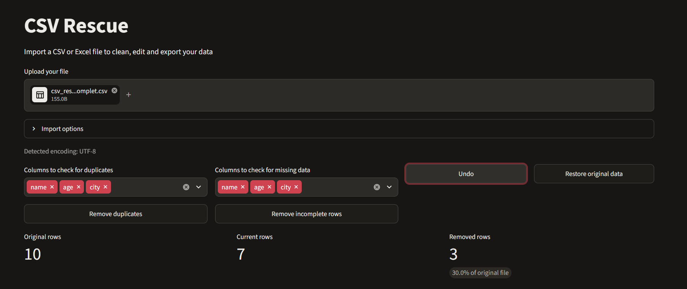
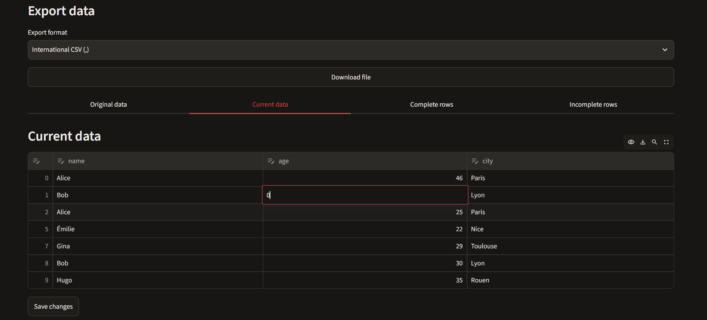
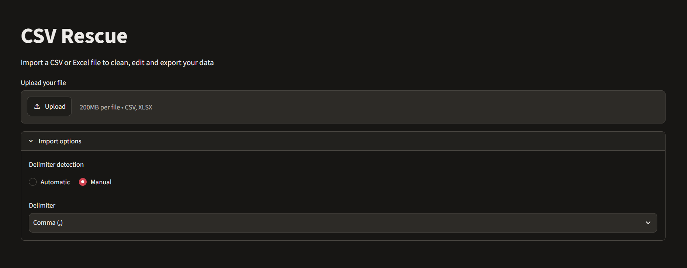
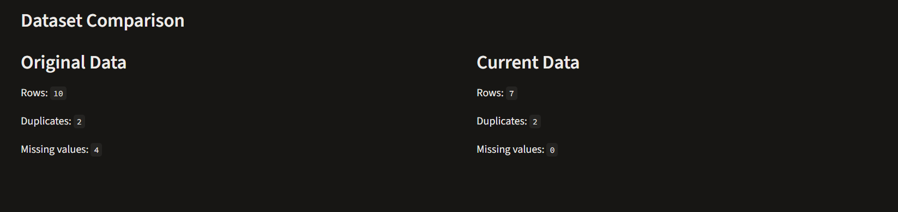
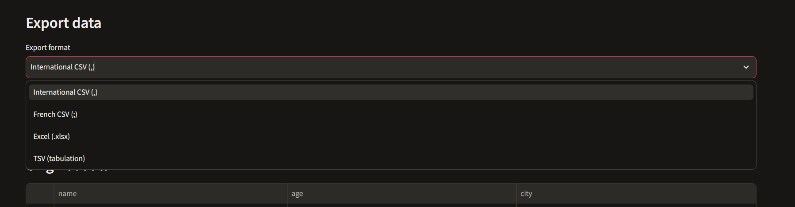
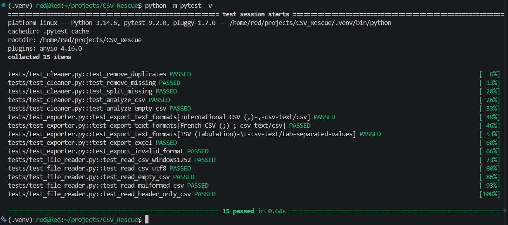

# CSV Rescue

**A simple way to clean, review, and export CSV and Excel data.**

CSV Rescue is a browser-based data-cleaning tool built with **Python, Pandas, and Streamlit**. Upload a dataset, remove duplicates or incomplete rows, make targeted edits, and download the result in your preferred format.

The interface is designed for two workflows: **quick cleanup and export** near the top of the page, or **detailed row-by-row editing** further down.

**[Source code](https://github.com/PtitTonnerre/CSV_Rescue)** · **Live demo:** https://csvrescue.streamlit.app

## Preview

### Quick cleanup and export

Select the columns to check for duplicates or missing values, apply the cleanup, then scroll down slightly to export your updated dataset without navigating through the data editor.



In this example, removing incomplete rows reduces the dataset from **10 to 7 rows**. The remaining duplicate rows can be handled separately with **Remove duplicates**.

### Edit individual cells

The **Original Data** tab keeps the imported dataset available for reference. The **Current Data**, **Complete Rows**, and **Incomplete Rows** tabs let you make more precise changes and save them to the working dataset.



<details>
<summary>More screenshots: import options, comparison, and export formats</summary>

**CSV import options** — automatic delimiter detection or manual selection:



**Dataset Comparison** — the same cleanup reduces missing values from **4 to 0**, while duplicates remain at **2**:



**Export formats** — choose CSV, Excel, or TSV:



</details>

## Features

- **Automatic file-type handling** for CSV (`.csv`) and Excel (`.xlsx`) uploads.
- **CSV parsing options:** automatic delimiter detection, with manual support for comma, semicolon, tab, and pipe.
- **Encoding fallback:** UTF-8 (including BOM) and Windows-1252 for CSV files.
- **Column-aware cleaning:** remove duplicates based on selected columns, or remove rows with missing values in selected columns.
- **Interactive editing:** edit cells across the full working dataset or filtered complete/incomplete rows.
- **Undo and restore:** undo recent saved changes (up to five snapshots) or restore the original imported data.
- **Dataset metrics:** track original, current, and removed rows; compare duplicate and missing-value counts.
- **Four export options:** international CSV (`,`), French CSV (`;`), Excel (`.xlsx`), and TSV (tab-separated).

### Supported formats

| Format | Import | Export |
| --- | :---: | :---: |
| CSV (`.csv`) | Yes | Yes — comma or semicolon |
| Excel (`.xlsx`) | Yes — first sheet | Yes |
| TSV (`.tsv`) | Not as a separate upload type | Yes |

> **Note:** Excel import currently reads only the first sheet of a workbook. For CSV, switch to manual delimiter selection if automatic detection does not produce the expected columns.

## Getting started

### Prerequisites

- Python 3.11+ recommended (tested locally with Python 3.14.6)
- `pip`

### Installation

Clone the repository:

```bash
git clone https://github.com/PtitTonnerre/CSV_Rescue.git
cd CSV_Rescue
```

Create a virtual environment:

**Linux, macOS, or WSL**

```bash
python -m venv .venv
source .venv/bin/activate
```

**Windows PowerShell**

```powershell
py -m venv .venv
.venv\Scripts\Activate.ps1
```

Install dependencies and launch the app:

```bash
python -m pip install -r requirements.txt
python -m streamlit run app.py
```

Streamlit will display a local URL (typically `http://localhost:8501`).

## How to use

1. **Upload a file:** select a `.csv` or `.xlsx` file. Use **Import options** to override automatic CSV delimiter detection if necessary.
2. **Clean your data:** choose the columns to check and click **Remove duplicates** or **Remove incomplete rows**.
3. **Export immediately:** use **Export data** to download the current dataset in the format you need.
4. **Or edit manually:** open **Current Data**, **Complete Rows**, or **Incomplete Rows**, edit cells, then click **Save changes**.
5. **Review your results:** inspect the row metrics and **Dataset Comparison**. Use **Undo** or **Restore original data** if needed.

All exports use the **current working data**, not the read-only original view.

## Project structure

```text
CSV_Rescue/
├── app.py                    # Streamlit entry point
├── core/
│   ├── __init__.py
│   ├── cleaner.py             # Analysis and cleaning operations
│   ├── file_reader.py         # CSV and Excel file reading
│   └── exporter.py            # CSV, Excel, and TSV generation
├── state/
│   ├── __init__.py
│   └── history.py             # Undo snapshots
├── ui/
│   ├── __init__.py
│   ├── import_.py             # File upload and import settings
│   ├── cleaning.py            # Cleanup actions, undo, restore
│   ├── stats.py               # Row metrics and comparison
│   ├── export.py              # Export selector and download
│   └── editor.py              # Data tabs and cell editing
├── tests/
│   ├── test_cleaner.py
│   ├── test_file_reader.py
│   └── test_exporter.py
├── assets/
│   └── screenshots/
├── requirements.txt
├── requirements-dev.txt
└── README.md
```

The application separates **data processing** (`core/`), **session state** (`state/`), and **presentation** (`ui/`). The short `app.py` entry point composes these modules.

## Tests

The latest local test run (Python 3.14.6) reported **15 passing tests** across cleaning, CSV reading, and exporting (including reading exported files back).

Install development dependencies and run the suite:

```bash
python -m pip install -r requirements-dev.txt
python -m pytest -v
```

If you do not use `requirements-dev.txt`, install `pytest` separately before running the tests.

Test coverage includes duplicate removal, missing-value handling, dataset analysis, CSV decoding/parsing cases, and the supported export formats. **Excel import is supported by the application but is not covered by the 15 tests shown in the provided test run.**

<details>
<summary>View the latest local test run</summary>



</details>

## Known limitations

- Excel import uses the **first sheet** only, sheet selection is not available yet.
- TSV is an **export** option, not a separate upload format.
- Undo stores up to **five** previous working-dataset snapshots within the current Streamlit session.

## Tech stack

**Python** · **Pandas** · **Streamlit** · **openpyxl** · **pytest**

## Author

Created by **[@PtitTonnerre](https://github.com/PtitTonnerre)** as a Python and data-tooling portfolio project.

<!-- TODO: Add the Streamlit Community Cloud URL to the Live demo line once deployed. -->
<!-- OPTIONAL: Add a LICENSE file and a License section if you choose an open-source license. -->
